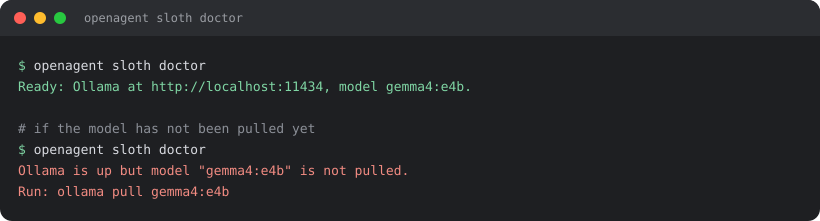
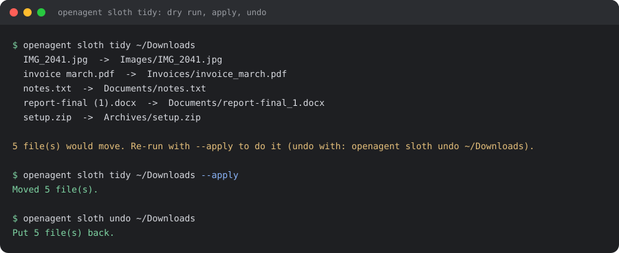
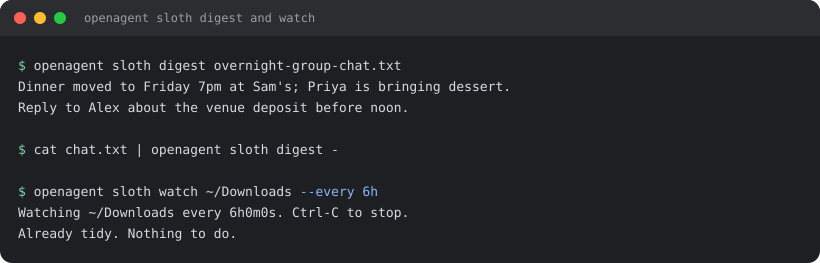

<div align="center">

# 🦥 open-agent-sloth

**Lazy local helpers that tidy your folders and digest your chats, powered by Gemma 4 E4B on your own machine.**

*No cloud, no API key, no account. Just `openagent sloth` and a small open-weight model.*

<br/>

[](./LICENSE)


</div>

---

> Built for the [Hacktoberfest Open-Source AI Challenge Week 3: Slow and Steady](https://dev.to/challenges/hacktoberfest-week3-2026-10-19).
> Sloth Mode is added on top of the open-source [OpenAgent](https://github.com/the-open-agent/openagent) project (Apache-2.0).

## What it does

| Command | What you get |
|:--|:--|
| `sloth tidy <folder>` | Sorts and renames a messy folder (Downloads, I'm looking at you). Dry run by default. |
| `sloth undo <folder>` | Restores the last applied tidy. |
| `sloth digest <file>` | A two-line summary of a chat export or any long text: what happened, and what needs a reply. |
| `sloth watch <folder>` | Runs the tidier on a slow timer so the folder stays clean. |
| `sloth doctor` | Checks that Ollama and the model are ready. |

It's for anyone with a chaotic Downloads folder, a group chat with 400 unread messages, or both.

## See it in action

Check that everything is ready:

<p align="center"></p>

Tidy a messy folder. It previews first, moves files only with `--apply`, and `undo` puts them back:

<p align="center"></p>

Digest a chat in two lines, or leave the tidier running on a timer:

<p align="center"></p>

> These are illustrative examples. File names and digest text will match your own folders and chats.

## Quick start

**Prerequisites:** [Go](https://go.dev/dl) 1.25+ and [Ollama](https://ollama.com).

```bash
# 1. Get the model (one-time) and make sure Ollama is running
ollama pull gemma4:e4b
ollama serve          # skip if the Ollama app is already running

# 2. Build
git clone https://github.com/JayanaGunaweera01/open-agent-sloth.git
cd open-agent-sloth
go build -o openagent .

# 3. Check everything is ready
./openagent sloth doctor

# 4. Use it
./openagent sloth tidy ~/Downloads                 # preview only
./openagent sloth tidy ~/Downloads --apply         # actually move files
./openagent sloth undo ~/Downloads                 # changed your mind
./openagent sloth digest overnight-chat.txt        # two-line digest
cat chat.txt | ./openagent sloth digest -
./openagent sloth watch ~/Downloads --every 6h     # tidy every 6 hours
```

On Windows, build with `go build -o openagent.exe .`.

## How it stays safe

- **Dry run by default.** Nothing moves until you pass `--apply`.
- **Undo.** Every applied run is logged in `.sloth-undo.json`.
- **Never overwrites** a file, and never touches hidden files or subfolders.
- **The model can't choose paths.** It picks from a fixed category list and proposes a name that is
  sanitised to `[A-Za-z0-9._-]`, so a confused or hostile reply stays inside the folder.
- **Works without the model.** If Ollama is down, tidying falls back to sorting by file type.
  `--no-model` forces that.
- **Small-model friendly.** Long chats are condensed chunk by chunk, so a small model with a short
  context can still summarise a big log.

## Configuration

| Variable | Default |
|:--|:--|
| `SLOTH_OLLAMA_URL` | `http://localhost:11434` |
| `SLOTH_MODEL` | `gemma4:e4b` |

Any model that Ollama can run works. Set `SLOTH_MODEL` to switch.

## Tests

```bash
go test ./internal/sloth/
```

The tests use a fake Ollama server, so no model is needed. They cover hostile model output, name
collisions, undo, the offline fallback and chunked digests.

More detail is in [SLOTH.md](./SLOTH.md).

## Built on OpenAgent

This project is a fork of [OpenAgent](https://github.com/the-open-agent/openagent), an open-source
personal AI assistant platform (Apache-2.0). Everything outside `internal/sloth/` and the small hook in
`internal/cli/cli.go` is OpenAgent's own code and keeps its original license headers. Sloth Mode only
needs the CLI, so you don't need to run the OpenAgent server to use it. For the full platform, see the
[upstream project and docs](https://github.com/the-open-agent/openagent).

## Author

Made by [Jayana Gunaweera](https://github.com/JayanaGunaweera01).

## License

[Apache 2.0](./LICENSE)
